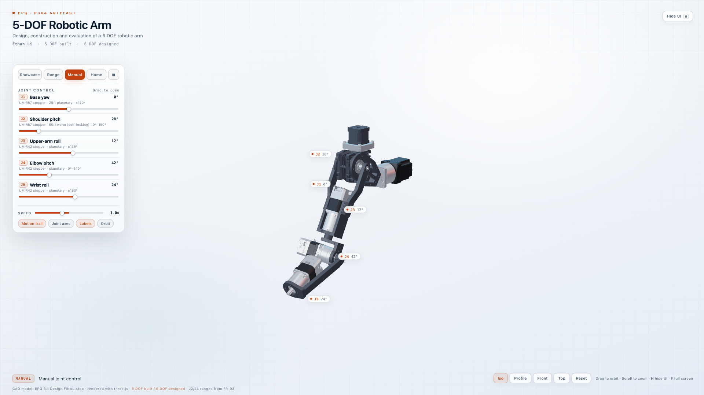
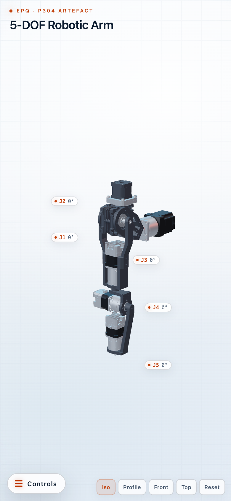
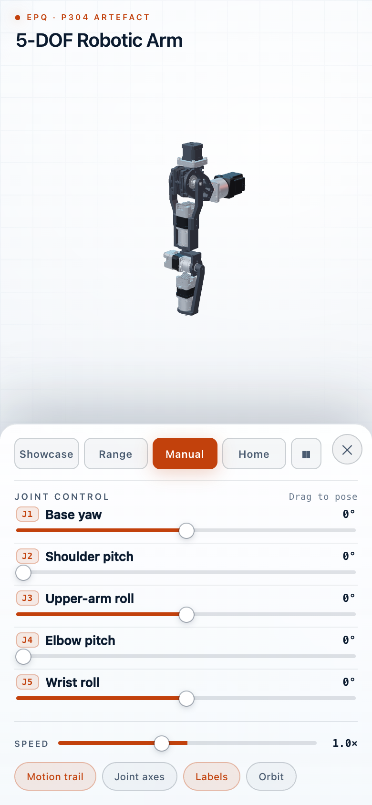

# 5-DOF Robotic Arm — interactive 3D visualiser

An interactive **three.js** visualisation of the 5-DOF robotic arm built for my EPQ
artefact: *Design, construction and evaluation of a 6 DOF robotic arm* (P304).

**Live demo:** https://ethanantoineli.github.io/HAVK/



The demo is one self-contained `index.html` (three.js, the CAD model and the UI are
all embedded), so it runs offline with no server and no external requests. Open
`index.html` in Chrome or Safari, or use the GitHub Pages link above.

## Features

- The **real CAD geometry** from `cad/EPQ-3.1-Design-FINAL.step` (Shapr3D) — not a
  procedural stand-in — articulated at all five joints (~290k triangles).
- A light drafting-paper palette: `#EEF2F7` paper, `#0B1B2F` text, `#C2410C` accent
  and a fine `#D3DDE8` grid.
- The arm **floats in mid-air** with no stand or floor, shown in its intended
  chest-mount orientation (the J1 motor axis is horizontal).
- All joints start at **0°**; **Home** returns to that rest pose.
- Three presentation modes:
  - **Showcase** — looping automatic motion sequence, good for talking over.
  - **Range** — sweeps each joint through its full travel, one at a time.
  - **Manual** — drag any joint slider (or click it and use the arrow keys).
- Camera presets (**Iso / Profile / Front / Top**), mouse orbit and scroll zoom.
- Toggles for **motion trail**, **joint axes**, **labels** and auto-orbit; adjustable
  playback speed; pause, hide-UI and full-screen.

Keyboard: **Space** pause · **H** hide interface · **F** full screen · **R** reset
camera · **1–5** select a joint for arrow-key nudging.

## On a phone

The layout is responsive. On phones the side panel starts **hidden**, so the 3D
arm fills the screen; tap **Controls** (bottom-left) to open the control sheet. The
3D view shrinks above the sheet so the arm stays visible while you drag the joint
sliders. Close the sheet with **✕** or by tapping anywhere outside it. The camera
presets stay in the bottom-right bar, and the panel's joint sliders, modes,
speed and toggles are all usable by touch.

<p>
  
  
</p>

## About the model

| Joint | Motion | Range | Actuator (from the report) |
|---|---|---|---|
| J1 | Base yaw | ±120° (modelled) | UMIR57 stepper + 25:1 planetary, 19 N·m |
| J2 | Shoulder pitch | 0°–150° (FR-03) | stepper + 50:1 self-locking worm, 5.4 N·m |
| J3 | Upper-arm roll | ±135° (modelled) | UMIR42 stepper + planetary |
| J4 | Elbow pitch | 0°–140° (FR-03) | UMIR42 stepper + planetary |
| J5 | Wrist roll | ±180° (modelled) | UMIR42 stepper + planetary |

The 6th DOF was designed but not built (actuator budget), so it is not animated.
The CAD has no end effector, so J5 drives its output shaft only and the wrist roll
is deliberately subtle — turn on **Joint axes** to see a small reference triad.

The linkage groups were matched to the real hardware: each joint's mounting
bracket stays with its upstream link, and only the output side rotates. The
upper-arm sleeve and both halves of the elbow connection are fixed with the J2/J3
structure.

## Repository layout

```
index.html                 single-file, offline demo (GitHub Pages entry point)
previews/                  desktop and phone stills used in this README
cad/                       original STEP assembly
three-arm/                 source used to build index.html
  build.mjs                embeds model/arm-opt.glb + src/ into index.html
  src/                     scene, motion, UI and loader code
  model/arm-opt.glb        optimised articulated glTF binary
  tools/                   STEP → GLB exporter and glTF optimiser
  qa.mjs                   headless functional checks (Chrome required)
  previews.mjs             regenerates the preview PNGs
```

## Run locally

Download or clone the repository and open `index.html` in a browser. Everything is
embedded, so no local server or internet connection is needed.

## Rebuild the demo

```bash
cd three-arm
npm install
node build.mjs      # writes ../index.html
node qa.mjs         # optional, requires Google Chrome
node previews.mjs   # optional, regenerates previews/
```

To regenerate `model/arm-opt.glb` from the STEP file you need the OpenCASCADE
Python bindings (`pip install cadquery-ocp`) plus the small optimiser toolchain in
`three-arm/tools/package.json`; see the headers in `tools/export_model.py` and
`tools/optimize.mjs`.

Built with [three.js](https://threejs.org) r170, bundled with esbuild.

## Credits

CAD model, design and EPQ project: **Ethan Li**. Rendered with three.js.
Please ask before reusing the CAD files or the project assets.
